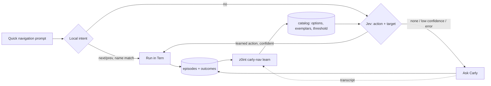

# Carly navigation inlet

Tern navigation without a Carly model turn. The set of navigation actions that
Jev can choose from grows from what Carly actually does.



## Pieces

| Piece | Path |
|---|---|
| Tern window plugin | `harness-adapters/tern-carly-nav/` |
| Hot path, inlet, learner, tuner | `src/z0int/carly_nav/` |
| Private state | `~/.z0int/state/carly_nav/` (`catalog.json`, `episodes.jsonl`, `outcomes.jsonl`, `universe.json`, `labels.jsonl`, `tuning.jsonl`) |

The Python side is stdlib-only, so the plugin starts it with
`PYTHONPATH=<repo>/src python3 -m z0int.carly_nav decide` and needs no install.
Set `Z0INT_PYTHON` in Tern's environment to choose another interpreter.

## Install

```sh
tern plugin link harness-adapters/tern-carly-nav
```

Press `ctrl+alt+shift+space` (palette: **Carly: Quick navigation**), type a
request, press Enter. Toasts name the backend (`local`/`jev`), its confidence and
the latency. Anything the fast path does not take goes to Carly unchanged.

## How the inlet learns

Ground truth, cheapest first:

1. **Fallbacks.** When Jev passes, Carly handles the request. `learn` finds her
   turn in `~/.cache/tern/carly/*/sessions` (same text within 10 minutes) and
   reads which Tern action her tools ran (`run_command`, `actions`, or
   `cx:command`/`cx:action`/`cx.layout:focus` in `lua`). A turn with no
   navigation is a true `none`; a turn with several different actions is skipped.
2. **Kept** fast-path actions are positive labels.
3. **Undone** actions are negative labels: focus returning to the previous block
   within 4 seconds.

Only user utterances and action ids are stored; no Carly replies are copied.

`z0int carly-nav learn` (offline, no model calls):

- **Promotes** a Tern action to a Jev option after Carly ran it for 3 distinct
  recent phrasings. Jev cannot invent options, so candidates come only from
  Carly's actual actions, checked against Tern's own action list (`universe.json`,
  reported by the plugin).
- **Never learns** actions that can lose work (close, kill, quit, delete, reset,
  restart, send, commit, …). Those stay with Carly; `learn` reports them as
  `blocked`.
- **Adds exemplars**: phrasings Jev missed first, then the shortest distinct ones,
  up to 3 per option. Jev reads literally, so boundary phrasings move accuracy.
- **Retires** learned actions unused for 30 days to keep the option list short.
- **Calibrates** the confidence cut: the lowest value that holds 95% precision
  over at least 20 judged Jev decisions; otherwise it keeps 0.4.

Unsupported navigation (session switches, arranging, opening files) is counted
in `learn` output so the next executor type is chosen from data.

## Sizing the request for Jev

Jev's guide: a choice takes up to 255 options, give the full list plus a way out,
and factor large decisions. The hot path sends one request with two questions:

- `action`: active options plus `none`, ordered seeds-then-support, capped by
  `policy.max_actions` (default 64).
- `target` (only when `focus` is offered): open tabs and blocks plus `none`,
  capped by `policy.max_targets` (64). The state lists the same names, so the
  action question knows what exists.

`z0int carly-nav tune` measures instead of guessing. It replays up to 40
labelled requests against Jev at budgets {all, 32, 16, 8} and keeps the smallest
budget within 1 point of the best accuracy, recording latency. It makes real API
calls (budgets × rows) and refuses to run with fewer than 20 labels.
`--dry-run` measures without changing the policy.

## Commands

```sh
z0int carly-nav status     # catalog, policy, episode and outcome counts
z0int carly-nav learn      # mine episodes + Carly transcripts, update catalog
z0int carly-nav tune       # live option-budget replay (Jev calls)
```

## Verification and limits

- `tests/test_carly_nav.py`: decisions, thresholds, promotion, blocked actions,
  ambiguity, exemplars, retirement, calibration, budget choice.
- Live Jev: an unknown request (`zoom into this pane`) returns `none`. After 3
  Carly turns running `zoom`, `learn` promotes it, and an unseen phrasing
  (`blow up this block to full size`) routes to `zoom`. A missed phrasing
  (`flip one tab over`: `none` 0.48) became an exemplar and routed to `next_tab` (0.96).
- In Tern (headless `serve`, Carly Lua VM, real plugin source): local focus and
  `previous tab`, Jev focus, learned `zoom` changing the tab to zoomed, fallback
  to Carly, and the universe report (207 actions).
- Not yet verified in a signed-in desktop window: the keybind, the prompt field,
  and focus-based undo detection. An isolated window stops at Tern's closed-beta
  sign-in, which tests must not bypass.
