# Work-item lifecycle statechart (loop 1)

The first, smallest loop of a separate "statechart, then verify" layer:
draw the flow, state its laws, prove the laws in Bend, then replay real
events through the same machine and flag every move the laws forbid.
Goal: deterministic, repeatable workflows, so the same failure is caught by
code the second time instead of by Kevin.

It targets three failures seen on 2026-10-20:

1. Company OS showed a stale static `main` while the live branch was 31 commits ahead.
2. Dash's phone ran a branch missing ~3 merged features.
3. Workers died mid-task and their work was never integrated.

## The statechart



Source: [`work-item.mmd`](work-item.mmd), generated from
`src/z0int/fsm/work_item.py` (`python -m z0int.fsm.export --mermaid
docs/fsm/work-item.mmd`); a test fails if the committed diagram drifts.

```
Proposed -> Claimed(coder) -> Implementing -> Verifying -> DraftPR -> Integrated
         -> Deployed -> OwnerAccepted -> Merged
side states: Blocked, Interrupted, Abandoned
```

Each transition names the roles allowed to make it and the evidence it
needs (`TRANSITIONS` in `work_item.py`). Roles come from
[`roles-v0.md`](../roles-v0.md):

| role | in this machine |
| --- | --- |
| Owner (Kevin) | accepts deployed results; may merge; may unblock/abandon. His actions go through the batched needs-Kevin queue (L7). |
| Opus | may claim/implement/resume; may integrate and deploy as orchestrator; may unblock/abandon |
| Sol (pi/SoL-Pi, omp) | may claim/implement/resume |
| Chat (ChatGPT app, Grok, Muse) | advice and specs only: never implements, never origin actions |
| Free models, Jev, SLMs | never implement; outside this loop they pick, rank, triage |
| CI (deterministic code) | verifies (test receipts), integrates and deploys behind checks, observes services, merges on recorded acceptance |

`owner_availability` is an input (`available_deep_work | low_energy | off`).
While he is `off`, owner actions are held; everything else keeps moving.

## The laws (all proven in Bend, see `bend/work_item_fsm/README.md`)

| | law | why the owner cares |
| --- | --- | --- |
| L1 | Merged only after OwnerAccepted (by the owner, not the author) | nothing reaches the default branch on an agent's say-so |
| L2 | no actor approves its own gate | a worker cannot grade its own homework |
| L3 | DraftPR needs a passing receipt bound to the head SHA; Integrated needs one for the integration head | "tests passed" means *these* bytes passed |
| L4 | Deployed head == Integrated head; drift voids the deploy | the stale-service bug |
| L5 | Interrupted leaves only by Resume (head kept) or explicit Abandon | dead workers' work is never silently dropped |
| L6 | only Opus/Sol implement | free models and choosers never write code |
| L7 | owner decisions wait in a batched queue and never block other items | Kevin's attention is the bottleneck; it must not stall the factory |

Verified: `hermes bend verify` receipt `9cebaacd…` **PASS** (kernel
recheck, Bend 2.0.34, Lean 4.34.0); 10/10 law-breaking mutants rejected;
Python twin equal to Bend on 400 seeded tapes.

## The replay checker

```bash
PYTHONPATH=src python -m z0int.fsm.replay \
  --services examples/fsm/services.groot.json \
  --repos kvnloo/company-os kvnloo/dash kvnloo/noop \
  --owner-availability off --out report.json
PYTHONPATH=src python -m z0int.fsm.export --report report.json \
  --receipt bend/work_item_fsm/receipt.json --overlay overlay.json --public public.json
```

Read-only: `gh` queries, `git ls-remote`, `git merge-base`, `ss`, `/proc/<pid>/cwd`,
Hermes delegation logs. No fetch into checkouts, no restarts.

| source | mapped to |
| --- | --- |
| PR opened | Claim, Start, Push(head), Submit by the author |
| check runs on the head, all test checks green **and finished before the merge** | Verify(CI, receipt bound to head). Label/stale/receipt-bot checks are not test receipts. |
| merged into a non-default branch | Integrate(merger, merge commit, check runs on the merge commit) |
| merged into the default branch | Merge (needs OwnerAccepted: an APPROVED review by the owner or an `owner-accepted` label) |
| closed unmerged | Abandon (v0 has no DraftPR->Abandoned edge, so these show as `closed_outside_statechart` info) |
| a listening port whose process cwd is a git checkout | Deploy(served head) against the service's declared integration ref |
| delegation log `end status=interrupted`, or no final line and no write for 60 min | Interrupt; a later task naming its delegation id/branch/worktree, or a RESUME task sharing ≥35% of its goal words, is Resume; a PR for its branch resolves it |

Severity: **violation** (a law the evidence breaks), **indeterminate** (the
evidence cannot decide, e.g. author and merger are the same shared GitHub
account), **candidate** (breaks a proposed v1 law), **info**.

### What it found on real data (2026-10-21 03:57 UTC)

174 items: 111 PRs, 5 services, 59 interrupted or vanished workers.

**Stale deploys (L4), reproduced:**

- `company-os-static :8788` serves `main@3d0f6eb`; the integrated line
  `parent/company-os-integrated@248126e` is **31 commits ahead**: the
  "stale static main" finding, now caught by code. It is also 1 behind
  `origin/main` (#4).
- `parent/company-os-integrated` **exists only in one local checkout** (no
  upstream): the live Company OS line can be lost with one `rm -rf` (L5 spirit, flagged).
- `z0intelligence :11501` serves a local `master@4de1aa9` that is 12 behind
  and 3 ahead of `origin/master`, with **27 uncommitted files**: what runs is
  not any commit.
- Dash `:4747`/`:8097` now serve `integrate/dash-20261020@effd9a2` ==
  integrated head (redeployed 20:43); they lack only `main`'s #49 (docs).
  The earlier "phone missing ~3 features" state is not in any log (systemd
  kept no working directory for the pre-20:43 runs), but the checkout sweep
  shows it: the default checkout `products/dash` (`integrate/dash-v2`) and
  7 other worktrees **would miss all of #71, #72, #73** (the three features merged
  into `integrate/phone-20261020`). Starting the service from the default
  checkout reproduces the bug.

**Receipts (L3):** 39 integrations without a passing receipt on the head:
29 noop PRs and 1 Dash PR with no test checks at all; 7 Dash PRs **merged
before their tests finished** (e.g. #73 merged at 16:42, `test` and
`required-gates` completed 16:43); 2 with failing checks (1 Dash, 1 noop).

**Owner acceptance (L1):** 6 merges to a default branch (dash #1, #2, #14,
#18, #49; company-os #4) with no recorded owner acceptance. All were merged
by the `kvnloo` account; agents use the same account, so whether Kevin
pressed merge is not observable. **L2 is indeterminate for the same
reason** (5 integrations where author == merger account).

**Interrupted workers (L5):** 26 interrupted + 33 vanished (log stopped,
no final status) delegations; 13 dropped past the 2 h TTL with no resume,
no PR and no abandon decision (e.g. the review-portal P1 builder, 5 Tern
fix/tester workers from one delegation, the ACE architecture v2 lane); 5 still inside the window.

**Stranded integrations (candidate law):** 32 PRs merged into a branch that
is on neither the default branch nor any running service (26 into noop's
`feat/local-access-query-stack`, dash #45 into `overnight/critical-path-20260910`).

**needs-Kevin queue** (owner `off`, held for the next block): 3 deployed
heads awaiting acceptance (Dash bridge, Dash Metro, Company OS chooser).

Limits: heuristics above are not proven; GitHub keeps only the latest run
per check; worker resume detection can miss a resume done outside the
delegation system; the services file is a declaration someone must keep true.

## Company OS overlay contract

`python -m z0int.fsm.export --overlay` writes `z0.fsm.work-item.overlay/v0`
([example without items](overlay.example.json)): `statechart` (states,
transitions with roles/evidence/law, laws with Bend names, roles), `proof`
(receipt id, verdict, manifest hash, scope), `summary`, `needs_kevin`, and
`items[]` (`id, kind, title, phase, needs_kevin, url, repo, violations[],
indeterminate[], candidates[]`). Company OS (xyflow) draws one node per
state, items as badges, refused moves as red edges. Display only: no field
authorizes anything. The full overlay contains worker goals and stays local
(`workspace/zer0/data/operations/fsm/`); the public summary drops them.

## How this relates to what exists

| existing | relation |
| --- | --- |
| z0int task loop (`task_loop.py`, `z0int.task_checkpoint.v1`: authorized -> resolved -> worktree_ready -> patched -> execution_completed -> verified) | the inner loop of one worker inside `Implementing`/`Verifying`. Its durable checkpoint is what makes L5's Resume cheap. Next step: emit its status changes as statechart events. |
| AODL gate (`exp/bend-aodl-gate`, `bend/aodl_gate`) | same method one level down: AODL proves what a *spawn* may do; this proves what a *work item* may do. Same Bend toolchain, receipt format and "proof is not authorization" rule. |
| shadow network promotion (z0evals#93, ROLES-v0) | L6 is the coding slice of it: SLM/Jev/free never implement. Promotion of an SLM for GUI choices belongs in loop 2's Decide state, not here. |
| `integration-debt` / `role-ledger` z0evals studies | not landed yet (only an untracked `studies/role-ledger/tools`). This checker produces integration-debt evidence directly; the role ledger should replace ROLES-v0's guesses in the role table. |
| Verified OSS Loop (preview/nightly channels) | L3/L4 are its exact-head-evidence rule made executable. Note: z0intelligence `preview`/`nightly` are 63 commits behind `master` (last moved 2026-09-18): the channel itself is stale. |

## Next loops

Worker supervision was built second: [worker-supervision.md](worker-supervision.md)
(`bend/worker_supervision_fsm`, `python -m z0int.fsm.supervise`). Proposals:

**Loop 2: GUI action loop.** `Observe -> Decide(tier0 word match -> promoted
SLM >= 0.95 -> Jev -> owner queue) -> Act -> CheckLanded -> (Observe | Done |
Escalate)`. Laws: never type without a foreground check of the target app
(S25: never while Kevin is using it); a hard-to-undo action needs an owner
yes (through the batched queue, L7); Act is followed by CheckLanded before
the next Act; an SLM acts only on a promoted task family at >= 0.95. Replay:
`phone_goal`/`phone_exec` traces and the S22+ `flock` logs.

**Loop 3 (built as loop 2, see [worker-supervision.md](worker-supervision.md)): worker supervision.** `Dispatched -> Running -> (Done | Interrupted
-> Resumed | Abandoned)`, with heartbeats. Laws: an Interrupted worker is
resumed from its checkpoint or explicitly abandoned within TTL; no two
workers own the same worktree; a resumed worker starts from the last pushed
head. It is the inside of this loop's L5 and consumes the same logs.

**Owner-attention loop (asked for by Kevin).** States `Off -> LowEnergy ->
DeepWork` derived locally from NOOP/Oura sleep, resting HR and HRV,
ActivityWatch focus time and app switching, time of day and a one-tap
self-report (self-report wins). It drives `owner_availability` for loops
1-3: show the needs-Kevin queue at the start of a deep-work block, as a
2-minute phone review when low-energy, never while off unless urgent and
irreversible. Laws: no signal leaves the host (local only, aggregate only,
skills `activitywatch-local-sync`, `privacy-first-activity-telemetry`); an
item reaches Kevin only with its evidence attached and at most one
decision; at most N interruptions per block. Replay: past queue
timestamps against the inferred state.
