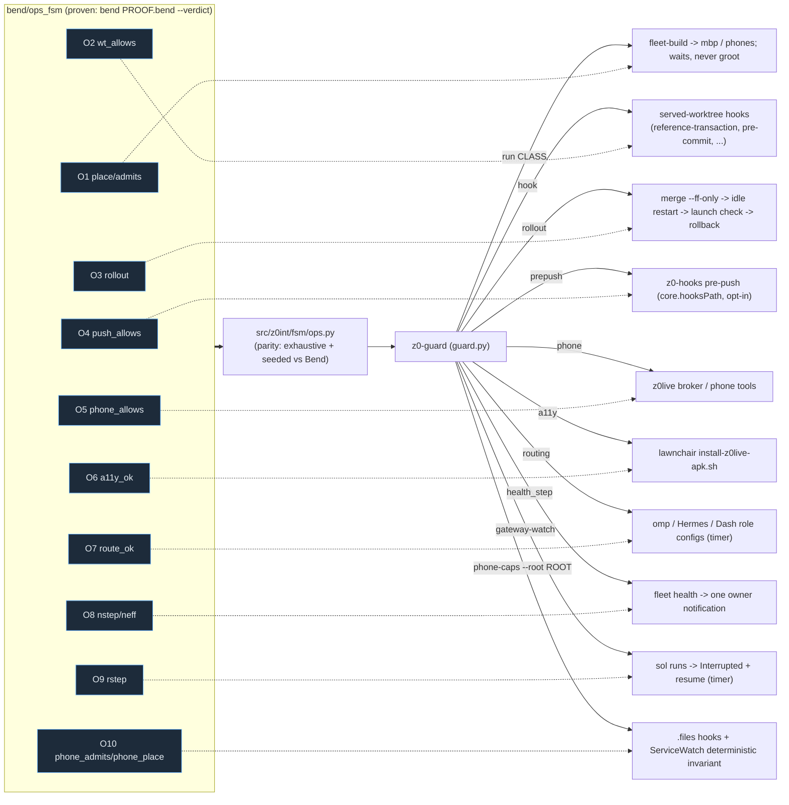

# Ops plane: operating rules as Bend laws with deterministic gates

Owner ask (2026-10-21): "can we continue setting up more bend rules for deterministic rules
like this instead of just a rule in an md file?" That day nine operating rules lived in
markdown or prompts and were broken anyway. Each is now a law in `bend/ops_fsm/LAWS.bend`,
proven in `PROOF.bend` (Lean-kernel rechecked), held load-bearing by mutants, mirrored by
`src/z0int/fsm/ops.py` (parity-checked against the Bend book) and enforced or reported by
`z0-guard` at the point where the bad action happens.



A Bend PASS covers Bend's emitted book: the decision functions over abstract inputs. How a real
command, git ref update, adb dump or config line becomes those inputs is classifier code in
`ops.py`/`guard.py`, tested but not proven. A receipt is CI/spec evidence, never an authorization.

## Laws, gates, modes

| law | rule (precise wording) | gate (where it bites) | default |
| --- | --- | --- | --- |
| O1 | test, mutation, typecheck, gradle, bundle, eval, screenshot-run jobs run only on a non-groot lane (mbp, phones); groot admits gpu, bend, lean, service, agent-process, tiny (<10 s). No room: wait, never groot. | `z0-guard run CLASS -- CMD` (heavy -> `fleet-build`); `fleet-build` refuses `--node groot` and logs the class | enforce |
| O2 | a worktree holding a live-service lease accepts no edit, commit, checkout, stash or merge, except `merge --ff-only` and its own rollback inside the `z0-guard rollout` transaction, which restarts the idle service at once | hooks installed by `z0-guard served install-hooks` (reference-transaction refuses ref moves without the rollout token; a refused update's files are restored); `z0-guard rollout` | enforce |
| O3 | restarting a service that serves the owner's device needs (a) a candidate from a clean non-served worktree, (b) a passing launch check on the real runtime after restart, with automatic rollback, (c) an orchestrator review receipt for review-gated PRs. The check never runs while O5 refuses; the rollout is then pending. | `z0-guard rollout` | report |
| O4 | an artifact marked private (repo private, `.z0-private` dir marker, `z0-private` git attribute, or `~/.config/z0-guard/private-paths` glob) is never pushed to a remote not known to be private (unknown fails closed) | `z0-hooks` pre-push template (`scripts/z0-hooks-install` in kvnloo/.files) -> `z0-guard hook pre-push` | enforce (opt-in install) |
| O5 | a UI input on the owner's phone needs an explicit owner phone-operation intent and the expected app in front; installing/restarting an app in the call chain (Lawnchair) is refused while a z0live call is live (unknown call state counts as live) | `z0int.fsm.guard.phone_decision(...)` / `z0-guard phone` (z0live broker call site below); `install-z0live-apk.sh` | report |
| O6 | after an install, enabled accessibility services ⊇ before, minus services the owner removed | `install-z0live-apk.sh` -> `z0-guard a11y` (mirror `a11y-superset.sh`, parity-tested) | enforce |
| O7 | no role routes to a cancelled provider (xai/grok, cancelled 2026-10-21); visual/UX design roles never route to Sol | `z0-guard routing` (hourly timer, read-only, never prints key fields) | report |
| O8 | a worker node unhealthy for >30 min emits exactly one owner notification per unhealthy episode | `fleet health` -> `guard.health_step` -> KDE Connect ping to the S25 (enforce) | report |
| O9 | when the gateway hosting headless runs restarts (gateway invocation or Hermes checkout HEAD changes), every dependent run gone without a report becomes Interrupted, never Failed, with a resume command | `z0-guard gateway-watch` (1-min timer) -> `o9-interrupted.jsonl` (+ `worker-decisions.jsonl` in enforce) | report |
| O10 | phone admission and placement are independent of agent-chosen memory, CPU, battery and thermal limits; Android manages resources. Explicit owner pause/call, reachability, capability, timeout and cleanup remain. Caller-explicit optional per-job memory is allowed; resource defaults and phone admission caps are not. | `z0-guard phone-caps --root ROOT` | enforce |

Switch a gate: `Z0_GUARD_O<n>=off|report|enforce` in the environment, or
`~/.config/z0-guard/modes.json` (`{"O3": "enforce"}`). `z0-guard modes` prints the effective modes.
Every decision is appended to `~/.local/state/z0-guard/decisions.jsonl`.

## O5 call site for the z0live broker (kvnloo/z0live#42)

The relay-status worker owns the broker's own phone-intent grammar
(`desktop/z0live_desktop/phone_control.py`). The ops gate is a pure function they can call
just before dispatching `phone_do`/`phone_act` or an install:

```python
from z0int.fsm.guard import phone_decision          # PYTHONPATH=<z0intelligence>/src
d = phone_decision("tap", intent=broker_says_phone_request,   # or utterance=latest_human_utterance
                   expected_app=pkg_the_plan_targets, foreground_app=pkg_in_front, call=True)
if not d["allowed"]:
    return {"refused": d["reasons"][0]}               # not_a_phone_request | foreground_mismatch
```

`z0int.fsm.ops.phone_allows(PKind.TAP, intent=..., fg=..., chain=..., call=...)` is the bare
decision (no IO). Pass `intent=` from the broker's own grammar so the two never disagree;
`utterance=` uses the shared fallback `ops.owner_phone_intent`.

## O10 scanner API

`phone_caps_findings(root: Path, paths: list[Path] | None = None)` is available from
`z0int.fsm.guard`. The root is mandatory: hooks must pass their own checkout,
not the guard's cwd. It returns stable `{path, line, rule, detail}` findings.
The CLI emits JSON with `gate`, `status`, `checked` and `findings`; enforce mode
returns 3 for findings and 0 when clean. Missing or malformed explicit files fail
closed as `scan-unavailable`. `--path FILE` is repeatable and replaces discovery,
including external paths, for isolated fixtures.

Discovery includes fleet scripts, the phone-mode registry, fleet docs, and the
known phone skill/report/chat-driver paths when present. Python AST parsing
distinguishes non-phone branches; YAML parsing checks phone mappings. Shell
mode branches and agent-facing prose use lexical checks. These are bounded
source checks, not a proof of arbitrary program semantics; Bend proves the
abstract admission/placement decisions, not the source classifier.

ServiceWatch's `phone_caps` deterministic invariant forces O10 enforce mode,
records caps as severe `phone_resource_caps`, and treats failed/unavailable
scans as `invariant_unavailable`. Its recurring check resolves the installed
fleet checkout; an inventory entry can specify `health_invariant` with
`{"kind": "phone_caps", "root": "/path/to/files"}`. No remediation is automatic.

## Evidence

- Proof: `bend/ops_fsm` receipt (`hermes bend verify`), mutants `bend/ops_fsm/mutations.json`.
- Parity: `python -m z0int.fsm.ops_parity` (needs Bend; groot).
- Incident replay: `python -m z0int.fsm.ops_replay tests/fixtures/ops_tapes/*.json`.
- Tests: `tests/test_fsm_ops.py` (MBP via fleet-build; the two parity tests need Bend).
