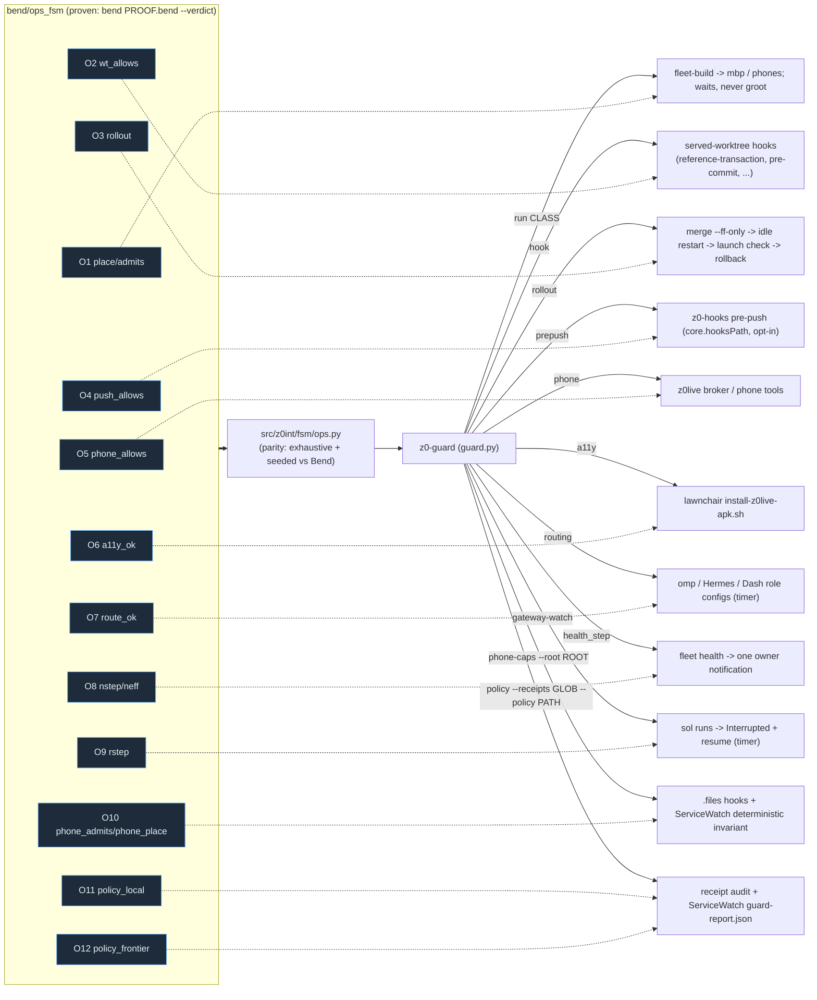

# Ops plane: operating rules as Bend laws with deterministic gates

Owner ask (2026-10-21): "can we continue setting up more bend rules for deterministic rules
like this instead of just a rule in an md file?" That day nine operating rules lived in
markdown or prompts and were broken anyway. Each is now a law in `bend/ops_fsm/LAWS.bend`,
proven in `PROOF.bend` (Lean-kernel rechecked), held load-bearing by mutants, mirrored by
`src/z0int/fsm/ops.py` (parity-checked against the Bend book) and enforced or reported by
`z0-guard` at the point where the bad action happens.



A Bend PASS covers Bend's emitted book: the decision functions over abstract inputs. How a real
command, git ref update, adb dump or config line becomes those inputs is classifier code in
`ops.py`/`guard.py`, tested but not proven. A receipt is CI/spec evidence, never an authorization.

## Laws, gates, modes

| law | rule (precise wording) | gate (where it bites) | default |
| --- | --- | --- | --- |
| O1 | test, mutation, typecheck, gradle, bundle, eval, screenshot-run jobs run only on a non-groot lane (mbp, phones); groot admits gpu, bend, lean, service, agent-process, tiny (<10 s). No room: wait, never groot. | `z0-guard run CLASS -- CMD` (heavy -> `fleet-build`); `fleet-build` refuses `--node groot` and logs the class | enforce |
| O2 | a worktree holding a live-service lease accepts no edit, commit, checkout, stash or merge, except `merge --ff-only` and its own rollback inside the `z0-guard rollout` transaction, which restarts the idle service at once | hooks installed by `z0-guard served install-hooks` (reference-transaction refuses ref moves without the rollout token; a refused update's files are restored); `z0-guard rollout` | enforce |
| O3 | restarting a service that serves the owner's device needs (a) a candidate from a clean non-served worktree, (b) a passing launch check on the real runtime after restart, with automatic rollback, (c) an orchestrator review receipt for review-gated PRs. The check never runs while O5 refuses; the rollout is then pending. | `z0-guard rollout` | report |
| O4 | an artifact marked private (repo private, `.z0-private` dir marker, `z0-private` git attribute, or `~/.config/z0-guard/private-paths` glob) is never pushed to a remote not known to be private (unknown fails closed) | `z0-hooks` pre-push template (`scripts/z0-hooks-install` in kvnloo/.files) -> `z0-guard hook pre-push` | enforce (opt-in install) |
| O5 | a UI input on the owner's phone needs an explicit owner phone-operation intent and the expected app in front; installing/restarting an app in the call chain (Lawnchair) is refused while a z0live call is live (unknown call state counts as live) | `z0int.fsm.guard.phone_decision(...)` / `z0-guard phone` (z0live broker call site below); `install-z0live-apk.sh` | report |
| O6 | after an install, enabled accessibility services ⊇ before, minus services the owner removed | `install-z0live-apk.sh` -> `z0-guard a11y` (mirror `a11y-superset.sh`, parity-tested) | enforce |
| O7 | no role routes to a cancelled provider (xai/grok, cancelled 2026-10-21); visual/UX design roles never route to Sol | `z0-guard routing` (hourly timer, read-only, never prints key fields) | report |
| O8 | a worker node unhealthy for >30 min emits exactly one owner notification per unhealthy episode | `fleet health` -> `guard.health_step` -> KDE Connect ping to the S25 (enforce) | report |
| O9 | when the gateway hosting headless runs restarts (gateway invocation or Hermes checkout HEAD changes), every dependent run gone without a report becomes Interrupted, never Failed, with a resume command | `z0-guard gateway-watch` (1-min timer) -> `o9-interrupted.jsonl` (+ `worker-decisions.jsonl` in enforce) | report |
| O10 | Phones receive all CPU/GPU and 100% RAM. Agent-selected phone resource caps are forbidden. Battery minima at or below 2% are allowed. Higher minima, including inherited health defaults, are forbidden. Explicit owner pause/call, reachability, capability, timeout and cleanup remain. | `z0-guard phone-caps --root ROOT` | enforce |
| O11 | A non-frontier route must have current policy stage canary or live that names this family and the full selected arm. | `z0-guard policy` | audit, exit 3 on violations |
| O12 | A healthy live arm requires offload. Frontier/Jev fallback requires a recorded confidence below the policy threshold. | `z0-guard policy` | audit, exit 3 on violations |
| O13 | Shadow/canary/live requests and configured arms/families cannot exceed their exact-scope measured option capacity. No valid compiled capacity means two options. | `z0-guard policy` | audit, exit 3 with offending IDs |

Switch a gate: `Z0_GUARD_O<n>=off|report|enforce` in the environment, or
`~/.config/z0-guard/modes.json` (`{"O3": "enforce"}`). `z0-guard modes` prints the effective modes.
Every decision is appended to `~/.local/state/z0-guard/decisions.jsonl`.

## O5 call site for the z0live broker (kvnloo/z0live#42)

The relay-status worker owns the broker's own phone-intent grammar
(`desktop/z0live_desktop/phone_control.py`). The ops gate is a pure function they can call
just before dispatching `phone_do`/`phone_act` or an install:

```python
from z0int.fsm.guard import phone_decision          # PYTHONPATH=<z0intelligence>/src
d = phone_decision("tap", intent=broker_says_phone_request,   # or utterance=latest_human_utterance
                   expected_app=pkg_the_plan_targets, foreground_app=pkg_in_front, call=True)
if not d["allowed"]:
    return {"refused": d["reasons"][0]}               # not_a_phone_request | foreground_mismatch
```

`z0int.fsm.ops.phone_allows(PKind.TAP, intent=..., fg=..., chain=..., call=...)` is the bare
decision (no IO). Pass `intent=` from the broker's own grammar so the two never disagree;
`utterance=` uses the shared fallback `ops.owner_phone_intent`.

## O10 scanner API

`phone_caps_findings(root: Path, paths: list[Path] | None = None)` is available from
`z0int.fsm.guard`. The root is mandatory: hooks must pass their own checkout,
not the guard's cwd. It returns stable `{path, line, rule, detail}` findings.
The CLI emits JSON with `gate`, `status`, `checked` and `findings`; enforce mode
returns 3 for findings and 0 when clean. Missing or malformed explicit files fail
closed as `scan-unavailable`. `--path FILE` is repeatable and replaces discovery,
including external paths, for isolated fixtures.

Discovery includes fleet scripts (including native `scripts/fleet-adb`), the
phone-mode registry, fleet docs, and known phone skill/report/chat-driver paths
when present. Python AST parsing
distinguishes non-phone branches. YAML checks phone mappings, inherited defaults
and referenced worker profiles. A phone's explicit health override replaces the
matching default. `min_battery_pct_on_battery: 2` passes, `40` fails.
The native Python battery gate `pct < 2 and not on_ac` is allowed, including
nested `power["batteries"][0]["pct"]` readings. Higher floors are findings.
Battery aliases retain their specific source taint. CPU, memory and temperature
aliases do not inherit the two-percent battery exception. Reassignment clears
that battery identity. Registry defaults are excluded only when the root's
`fleet.registry` explicitly merges empty defaults for phones and accesses shared
defaults only in its non-phone branch. Standalone YAML assumes inheritance.
Phone CPU counts cannot establish all cores and are flagged. `cpus: all`, `memory_pct: 100`
and equivalent uncapped markers pass. Discovery rejects a scripts directory
passed as the checkout root, even if external known files exist. Shell mode
branches and agent-facing prose use bounded lexical checks. These are bounded
source checks, not a proof of arbitrary program semantics. Bend proves the
abstract admission/placement decisions, not the source classifier.

ServiceWatch's `phone_caps` deterministic invariant forces O10 enforce mode,
records caps as severe `phone_resource_caps`, and treats failed/unavailable
scans as `invariant_unavailable`. Its recurring check resolves the installed
fleet checkout; an inventory entry can specify `health_invariant` with
`{"kind": "phone_caps", "root": "/path/to/files"}`. No remediation is automatic.

## O11/O12/O13 policy audit

```sh
z0-guard policy --receipts "$HOME/.z0int/receipts/*.jsonl" \
  --policy "$HOME/.z0int/policy/decision-policy.json" --since 24h --json
z0-guard policy --static /path/to/z0intelligence --json
```

`--since` accepts a nonnegative duration with `s`, `m`, `h` or `d`. JSON and JSONL
receipts use `ts`, `at`, `timestamp` or `created_at` with a timezone. JSON arrays
and `receipts`/`decisions` collections are supported. `policy_families` supplies
family-specific stamps for multi-family decisions. The audit counts unstamped
decisions and differences from the current content-addressed policy, including
its version, SHA, rule and stage. It does not reconstruct historical policies.
Scoped rules use `family` for the base family and `policy_family` for the
policy mapping key. The rule's base family must match. Its `scope` must match
the receipt's observed `scope`, or selected-arm fields when no explicit scope
exists. Frontier fallback can omit observed scope when no endpoint executed.
Consumers can record effective `stage: none` with `policy_stage` set to the
declared stage and a `policy_reason`. The audit compares the declared stage,
but still requires actual arm/scope identity for every non-frontier route.

Receipts identify the route with `route` or `tier`. `frontier`, `remote_frontier`,
`jev` and `bounded_jev` are frontier fallback arms. Other routes must include
`selected_arm` or `arm` with every identity field from the family policy arm.
A model string alone cannot prove the device/engine/quant/backend binding.
The finding's `kind` is not a physical identity field: an SLM finding can name
an engine deployment. Kind-only rules/knn arms still require a matching kind.
Physical arms require all five named and observed dimensions: model, quant,
engine, backend and device. Their matching policy serving entry also records
`expected_model_id`, `engine_build`, `model_path` and measured `model_sha256`.
Receipts carry `observed_identity` with `model_id`, `engine_build` and
`model_path`, plus `props_model_id`. Both observed model identifiers must match
the expected model ID. Build and path must match exactly. A non-null
`expected_identity` receipt snapshot must match the serving entry, including
its SHA-256. The guard requires the measured hash, but does not claim to hash a
remote model file itself. A missing model revision alone is not a violation.
Expired evidence does not authorize offload. O12 requires an explicit boolean
`serving_healthy` observation. An abstention is an object with numeric
`confidence` and `threshold`, where confidence is below the current policy's
threshold and the recorded threshold matches it. A boolean or missing confidence
does not establish abstention.

O13 reads only the compiled policy's `option_capacity` map. Keys are canonical
sorted compact UTF-8 JSON of exactly `model`, `quant`, `engine`, `backend`,
`device`. A value grants `allowed_k` only when it has nonempty `finding_ids`
and measured `task` names, finite `wilson_lower >= bar`, and a future
`expires_at`. Missing, invalid, expired or differently scoped capacity defaults
to **2**. The findings ledger cannot grant capacity to the guard.

The audit checks actual `option_count` in shadow/canary/live receipts, including
each model inside today's `shadow[]` envelopes (not the root's full legal
catalogue). Missing/invalid counts on actual SLM attempts are violations.
Session `data` wrappers inherit their timestamps. Rules/knn observations are
not SLM choices. An honest pre-request refusal records `slm_requested: false`,
`option_count: 0`, `attempted_option_count`, and reason
`option_capacity_exceeded` (or `option_bound_exceeded`); it is not an O12
offload failure or an O13 request.

The same policy home is audited for configured `option_count`/`candidate_k`
in `config/serving.json` endpoints, `shadow_learning` under `config/loop.json`
and `config/z0int.json`, `config/shadow.json`, `shadow/config.json`, and active
`loop/shadow-learning-status.json` projection configuration. A projection
without its own model is checked against each serving endpoint. Missing scope
dimensions do not earn credit. Active shadow/canary/live policy families with
`option_count` are checked too. `counts.o13_option_capacity` counts offending
entries; stderr findings carry each ID, scope, observed count and allowed bound.

The command writes the same JSON to stdout and
`$Z0INT_HOME/policy/guard-report.json` (default `~/.z0int/policy/guard-report.json`):

```json
{
  "schema": "z0.policy_guard.v1",
  "ts": "2026-10-24T12:00:00+00:00",
  "policy_version": null,
  "window": {"since": "2026-10-23T12:00:00+00:00", "receipts": 0},
  "counts": {
    "unstamped": 0,
    "stale_policy": 0,
    "o11_evidence_bound_route": 0,
    "o12_offload_obligation": 0,
    "o13_option_capacity": 0
  },
  "offload_rate": {},
  "available": false,
  "unavailable_reason": "no policy or stamped receipts"
}
```

Each live family's `offload_rate` entry contains integer `live_decisions`,
`offloaded`, `abstained` and `frontier` counts. Divide offloaded by live_decisions
to obtain the observed rate. A zero denominator means no observation, not 0%.
The report is unavailable when policy or receipt evidence is absent or corrupt.
If all live frontier decisions lack health observations, `unavailable_reason`
states how many lack them. Unknown health never establishes an O12 violation.
Exit codes are 0 for a clean available audit, 3 for violations, 4 for unavailable
evidence, and 2 for invalid arguments. Violations take precedence over
unavailability. Missing policy never prevents an operator's runtime turn.

`--static ROOT` flags literal credited-family lists and route assignments outside
`src/z0int/policy_runtime.py` and `omp-extensions/local-cognition/index.ts`, the
policy loader files. Python uses AST checks. Other sources use bounded lexical
assignment/property checks. Tests, fixtures, generated data and dependencies
are excluded. Detailed findings and a static finding count go to stderr, so
stdout retains the report schema. A static-only scan still reports receipt
evidence as unavailable. Static violations return 3.

The Bend model names full arm identities and families with natural identifiers.
O11 proves stage and both identity constraints. O12 proves healthy live fallback
requires abstention, with positive laws for unhealthy and abstained fallback.
O13 proves the hard capacity bound, default two, exact-scope credit, valid
boundary admission, and rejection of the observed 24/119-option shapes.
See `bend/ops_fsm/README.md` for the MBP proof, 63-mutant and parity commands.

### Synthetic evidence isolation

Findings, policy rules and receipts marked `synthetic: true` belong only in an
isolated temporary policy home. The guard also derives rule taint from its
evidence IDs in `<policy-home>/findings/findings.jsonl`, so removing a rule's
marker does not launder synthetic findings.

The guard resolves symlinks before it checks the policy home. The real `/tmp`
must be a proper ancestor. `/tmpfoo` does not qualify. The protected homes are
`realpath(~/.z0int)` and, when set, `realpath($Z0INT_LIVE_HOME)`. Protected homes
never qualify, even if they reside under `/tmp`. Live units set
`Z0INT_LIVE_HOME` explicitly. An isolated process's `Z0INT_HOME` is not evidence
of liveness. A symlink under `/tmp` into a protected home fails.

Each offending finding ID, rule ID and receipt trace/ID appears in stderr
findings with rule `synthetic-evidence-outside-tmp`. These findings increment
`counts.o11_evidence_bound_route` and return exit 3.

## Evidence

- Proof: `bend/ops_fsm` receipt (`hermes bend verify`), mutants `bend/ops_fsm/mutations.json`.
- Parity: `python -m z0int.fsm.ops_parity` (MBP with the supplied Bend toolchain).
- Incident replay: `python -m z0int.fsm.ops_replay tests/fixtures/ops_tapes/*.json`.
- Tests: `tests/test_fsm_ops.py` (MBP via fleet-build; the two parity tests need Bend).

## Law H: agent process placement (report only)

Run `z0-guard cgroup-placement` or `python -m z0int.fsm.cgroup_placement`.
The read-only Linux proc census identifies agent executables and their descendants
by process ancestry, including shell and native-tool children. It reports a
violation when their cgroup is outside `agent.slice` and
`z0-farm-llama.service` (exact path components). It never moves, signals, or kills
processes and always exits zero after reporting. Unreadable or changing process
identities and unidentifiable orphan interpreters are unknown, not compliance.
The JSON includes observed executable, cgroup, ancestry and timestamp; it is a
point-in-time report, not an authorization or continuous enforcement claim.
Synthetic proc tests are in `tests/test_cgroup_placement.py`; the decision laws
and four proof-rejected semantic mutants are in `bend/placement_fsm`.
For the live `/proc` census, read-only `systemctl --user show` also reports agent
scopes whose `OOMPolicy` is not `continue`, and active `hermes-gateway.service`
whose configured `Slice=agent.slice` differs from its running cgroup. A new
drop-in does not move an already-running service. Missing systemd evidence is
unknown; fixture proc roots do not query the live manager. These systemd sensors
are tested in Python; the finite Bend proof covers only the placement predicate,
not systemd settings, process discovery, or runtime restart application.

## R1 raw-mitigation pre-tool audit (opt-in, report-only)

`omp-extensions/root-cause/index.ts` registers OMP `tool_call`, not a
`pre_tool_call` event. It returns only `additionalContext` for findings containing
“use z0-guard mitigate”; it never returns `block`, rewrites input, executes a
command, applies a lease, or touches a target. No extension/config activation is
part of this change. Run its behavioral suite on MBP:
`bun test omp-extensions/root-cause/rule.test.ts`.

API discovery on 2026-10-24: the installed executable resolved to
`/home/kvn/.local/share/tern/omp/bin/omp`; its embedded user-agent identifies
18.12.6. Inspection of its embedded `async emitToolCall` implementation shows
handlers registered under `tool_call`, early return on truthy `block`, accumulation
of `additionalContext` and `input`, and conversion of handler errors/timeouts into
`block: true`. Therefore this report-only handler catches its own synchronous
audit failures and performs no awaited I/O. This is source inspection, not a live
hook execution test. The checkout comparator
`/home/kvn/tmp/oh-my-pi/packages/coding-agent/src/extensibility/extensions/types.ts`
likewise declares `type: "tool_call"`, `toolName`, `toolCallId`, and `input`
(lines 919–967). Do not substitute a Codex permission JSON contract.

The pure `auditTool(toolName, input, ownership?)` API reports `systemctl
set-property`, resource-file redirection/tee/copy/dd, direct file-tool writes to
`io.max`/`memory.max`, priority changes, and kill/pkill/killall with foreign or
unverified ownership. Priority changes are conservatively reported even when
service ownership is unknown. Host-supplied exact `ownedPids`/`ownedPatterns`
may identify an owned cleanup; caller-supplied tool arguments never establish
ownership. OMP currently supplies no ownership registry, so unknown targets
report rather than being silently treated as owned. Read-only probes are not
findings. The lexical scanner handles ordinary command lists, wrappers and
shell `-c` arguments, but is not a shell interpreter or security sandbox:
dynamic expansion, scripts, interpreter code and indirect paths require their
own audit boundary. Report mode must not be cited as prevention.

### Hermes `hooks.pre_tool_call` integration contract

This is the adapter contract to implement against the deployed Hermes version,
not a claim that a Hermes hook has been installed or its native callback
signature verified. Normalize the native event to `{toolName, input}` (mapping
Hermes `terminal` to the accepted terminal tool name); call the same pure rule
before executing the tool. Deliver each finding as **advisory context** with
`law=R1`, `mode=report-only`, `kind`, and `message`. Preserve all native input and
the normal execution result; do not set deny/block, return a refusal exit code,
or invoke `z0-guard mitigate` automatically. Errors must remain advisory in
report-only mode. Ownership must come from a trusted harness process registry,
never from the model's tool payload. A future Hermes adapter must test these
semantics against its native `hooks.pre_tool_call` callback contract before
activation. Switching either harness to enforcement requires separate approval.


### Read-only root-cause operational evidence (2026-10-25 UTC)

The private operations receipts are under
`/mnt/zer0models/workspace/zer0/data/operations/state-laws/`.
`root-cause-live-20261025.json` records the bounded ctx search/status timeouts,
failed refresh freshness, unavailable raw-inventory deadline, and failed
AgentsView sync. A timeout is unavailable evidence, not proof of an absent index.
`agentsview-search-live-20261025.json` records the separate bounded search.
No indexer or full raw-history census was restarted for this continuation.

`user-control-20261025.json` inventories eight remaining legacy resource drop-ins
as UN-LEASED. In particular, the Oct-19 ctx memory controls remain at High 4 GiB,
Max 5 GiB and SwapMax 2 GiB. The current systemd sample reports 4,699,049,984
bytes charged, above High; cgroup memory PSI full averages are 59.30/59.40/59.94
percent over 10/60/300 seconds. These observations support escalation of sustained
MemoryHigh pressure, not authority to alter limits. No ctx limit was changed.

The Hermes manual ctx repair receipt was imported into
`~/.local/state/z0-guard/root-cause/mitigations/ctx-repair-20261024.json`.
The original censored string baseline is retained in the derived sibling
`operations/unified-memory/ctx-repair-20261024/lease-typed.json`, alongside its
original receipt SHA and explicit `>=`, censored=true metadata; 200 seconds is a
lower bound, not an exact latency. Artifact hashes were checked by the importer.
Import returned `imported:true`, `guard_applied:false`, `executed:false`,
`decision:escalate`: the immediate functional probe failed and the manual change
does not create guard-owned rollback authority. Approval remains the cited
Hermes user receipt, not a new approval inferred from import.

Root acceptance job `fleet-mbp-00ab31c294a740b6` ran on MBP with 2 GiB,
one CPU: 480 pytest passed, one optional Bend pytest skipped; the separate
native Bend proof passed, Python/Bend parity matched 344/344 cases, and 40/40
mutants were rejected by owned proof diagnostics. The Bun hook suite passed
24/24. Receipts and log are under `~/.local/state/fleet/runs/` for that job.
The finite R1–R4/R7 model proves supplied predicates and unknown precedence,
not target ownership, successful remediation, unrestricted shell semantics,
future health, or permission to execute a rollback. No enforcement was enabled.
